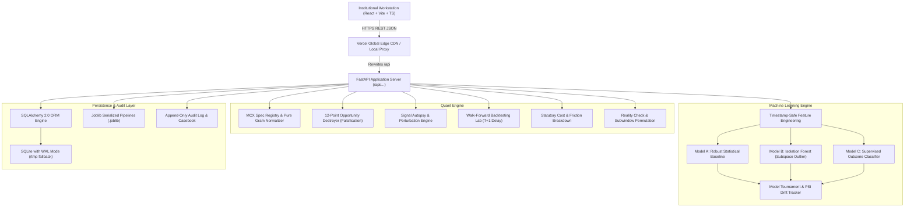
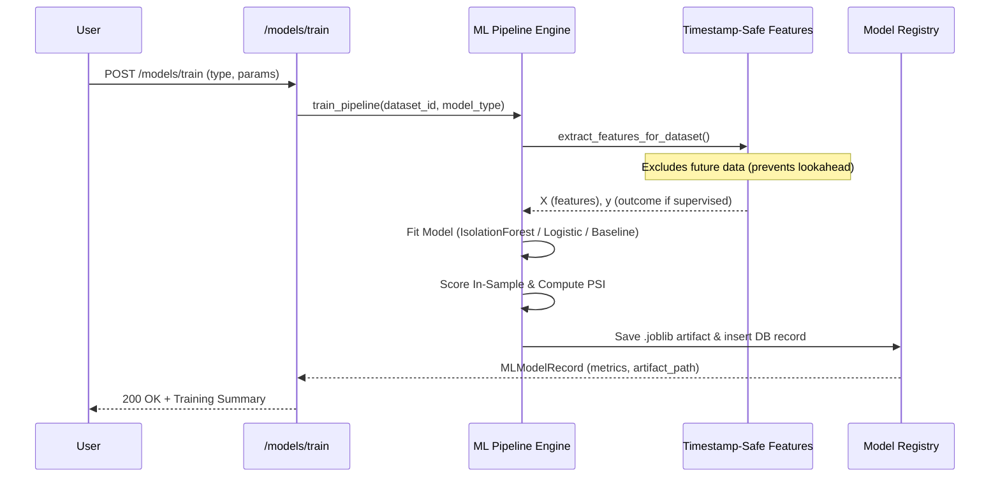

# GoldWise Pro — System Architecture

This document describes the architectural layout, data flow, statistical models, and runtime deployment boundaries of **GoldWise Pro**.

---

## 1. High-Level System Architecture

---

## 2. Quantitative Normalization Subsystem

MCX gold futures are quoted in heterogeneous market quotation units and purities:

| Symbol | Quotation Unit ($B$) | Contract Lot ($L$) | Purity Standard | Fineness Ratio ($F$) |
|---|---|---|---|---|
| `GOLD` | 10 grams | 1,000 grams (1 kg) | 995 fineness | 0.995 |
| `GOLDM` | 10 grams | 100 grams | 995 fineness | 0.995 |
| `GOLDGUINEA` | 8 grams | 8 grams | 999 fineness | 0.999 |
| `GOLDPETAL` | 1 gram | 1 gram | 999 fineness | 0.999 |
| `GOLDTEN` | 10 grams | 10 grams | 999 fineness | 0.999 |

### Normalization Invariant
To allow valid statistical arbitrage and relative-value surveillance, all market quotations are transformed into an absolute reference: **Pure Gold Price per Gram (INR/g)**:

$$P_{\text{pure\_gram}} = \frac{P_{\text{quoted}}}{B \times F}$$

Where:
- $P_{\text{quoted}}$ is the exchange quoted settlement price.
- $B$ is the quotation basis in grams (e.g., 10g for `GOLD`, 8g for `GOLDGUINEA`, 1g for `GOLDPETAL`).
- $F$ is the fineness purity decimal ($0.995$ or $0.999$).

Any relative spread $\Delta_{A,B}$ is strictly computed between normalized values:
$$\Delta_{A,B} = \frac{P_{\text{pure\_gram}, A} - P_{\text{pure\_gram}, B}}{P_{\text{pure\_gram}, B}}$$

---

## 3. Opportunity Destroyer Engine (Falsification Pipeline)

Rather than accepting high z-scores as alpha, GoldWise Pro implements a 12-stage falsification pipeline where an anomaly candidate must pass all checks before being deemed actionable:

1. **Physical Specification Mismatch**: Identifies false basis caused by unadjusted purity or quotation unit differences.
2. **Tick Size Granularity**: Discards apparent mispricings smaller than 2 minimum tick increments.
3. **Liquidity & Open Interest Gate**: Discards contracts with volume $< 10$ lots or OI $< 25$ lots.
4. **Bid-Ask Spread Cross Penalty**: Simulates crossing the bid-ask spread on both legs.
5. **Contract Expiry Cliff**: Suppresses trades within 3 trading days of contract expiration.
6. **Physical Delivery Tender Window**: Identifies delivery tender margin spikes (typically 25% incremental margin).
7. **Statutory Transaction Friction**: Deducts Exchange Turnover fees (0.001%), CTT (0.0125%), SEBI charges, and 18% GST.
8. **Brokerage & Financing Haircut**: Models financing cost of margin capital over expected holding period.
9. **Execution Delay (T+1)**: Eliminates lookahead bias by requiring entry at the next bar's price.
10. **Historical Mean-Reversion Half-Life**: Flags non-reverting structural basis trends ($t_{1/2} > 30$ days).
11. **Structural Regime Break**: CUSUM test for macroeconomic breaks (import duty adjustments, RBI policy).
12. **Model Consensus Verification**: Verifies baseline z-score aligns with machine learning anomaly probability.

---

## 4. Machine Learning Architecture

### Reproducibility Safeguards
- Deterministic synthetic generator with fixed seed (`seed=42`).
- Strict timestamp sorting before rolling window calculations.
- Feature extraction excludes target returns at time $t$ when predicting for time $t+1$.
- Models persisted as versioned binary artifacts via `joblib`.

---

## 5. Vercel Serverless Architecture

In a serverless environment (such as Vercel Functions):
1. **Filesystem**: The root directory is read-only. Writable scratch space exists exclusively under `/tmp`.
2. **Cold-Start Resilience**: `backend/app/core/config.py` detects `IS_VERCEL=1` and dynamically targets `/tmp/goldwise_pro.db` and `/tmp/artifacts`.
3. **Automatic Seeding**: `backend/app/main.py` proactive `init_db()` auto-seeds the SQLite schema and baseline MCX dataset upon cold-start if absent, ensuring zero manual database setup on deployment.
